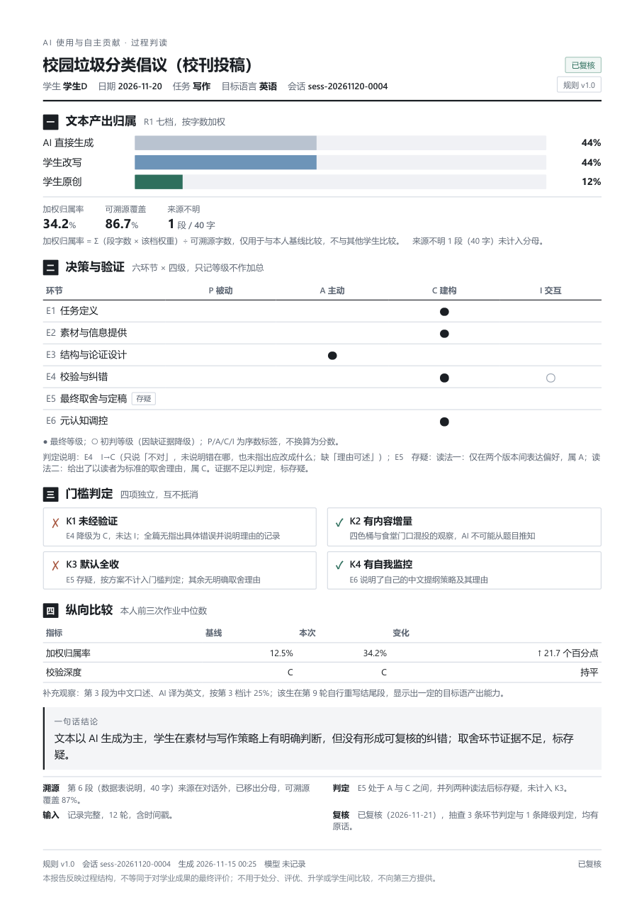

# ai-contribution-review

**A one-page report for teachers: who wrote the words, who made the judgments, and whether anything was actually verified.**

A student completes an assignment in a single chat session with an AI assistant. At the end, this skill reads that session and produces the report.

> **Status: experimental.** There is no validity or reliability evidence yet. The weights are expert guesses, not calibration results. Read [Limitations](#limitations) before using this on a real student.

Two packages, one model:

| Package | Directory | Host |
|---|---|---|
| Agent Skills | [`packages/agent-skills/`](packages/agent-skills/ai-contribution-review/) | WorkBuddy, Claude Code, any host that loads `SKILL.md` |
| DeepSeek Harness | [`packages/dsh/`](packages/dsh/ai-contribution-review/) | DSH (`~/.dsh/skills/`, `<project>/.dsh/skills/`) |

The rules, scripts and report layout are identical. Only the packaging differs.

No total score. No AI-text detector. Not for discipline, not for ranking.



## Why not an "AI rate"

When a teacher requires AI use, most of the text will be AI-produced. That is the design, not a failure.

A single "how much of this was AI" percentage marks every compliant student as a problem, and tells the teacher nothing they can act on.

So the report gives three blocks that are **never added together**:

| Reading | What it is | What it looks like |
|---|---|---|
| Text provenance | an observable fact | three bars + a weighted attribution rate — the only number that gets computed |
| Decisions and verification | verifiable behavior | 6 stages × ICAP levels, no total |
| Threshold checks | yes / no | four flags: verification, new material, rejection, self-monitoring |

The blocks are independent on purpose. Nothing in one can be used to correct another. A report that says "cannot assess" because the process record is missing is worth more than an invented "70%".

## Install

**Agent Skills**

```bash
git clone https://github.com/dudu20070305/ai-contribution-review.git /tmp/acr
cp -r /tmp/acr/packages/agent-skills/ai-contribution-review ~/.workbuddy/skills/
```

**DSH**

```bash
cp -r /tmp/acr/packages/dsh/ai-contribution-review ~/.dsh/skills/
python ~/.dsh/skills/ai-contribution-review/tools/check_format.py
```

Requires Python 3.9+. Standard library only. `pypdf` or `pymupdf` optional, used to check that the report really is one page.

## Use

**Mode A — before the assignment.** The teacher declares three things: target language, whether the learning objective includes producing text in the target language, and the task type. The second one decides whether the cross-language tier (25%) can be used at all. If it is not declared, the skill must not guess on the student's behalf.

**Mode B — after the assignment.** The student says "generate the report". Four steps:

```bash
# 1. write the judgments (fields in references/report-spec.md) -> analysis.json
# 2. compute text attribution
python scripts/compute_attribution.py analysis.json --write
# 3. check hard constraints (must be zero errors)
python scripts/validate_report.py analysis.json
# 4. render one A4 page
python scripts/render_report.py analysis.json
```

The validator rejects: composite score fields, C/I levels without evidence, downgrades of more than one level, threshold checks without a stated search scope, missing uncertainty notes, and vague conclusion sentences.

## What it refuses to output

- a single combined score
- integrity ratings, disciplinary recommendations, student rankings
- any stage judgment without a quoted piece of evidence

If the session transcript is missing, the report says so and drops to text provenance only.

## Design tradeoffs

| Choice | Why |
|---|---|
| No total score | the six stages are correlated; a weighted sum assumes an independence that does not hold |
| ICAP levels are ordinal only | the framework gives an order (I > C > A > P), not distances between levels |
| Thresholds instead of weights | some things cannot be traded: no verification cannot be offset by word count |
| Compare against the student's own baseline | expertise reversal: the same scaffold helps novices and hinders experts, so one cutoff misjudges both ends |
| No AI detector | general-purpose detectors are systematically biased against non-native writers |
| Write "cannot determine" when evidence is missing | an honest empty report beats a fabricated percentage |

## Limitations

- **No validity or reliability testing.** No construct, convergent or discriminant validity evidence. No inter-rater agreement data.
- **Tiny sample.** The rules were checked against three real transcripts from one person, one week, one level (university). K-12 is untested.
- **Self-reported by nature.** The report is generated on the student's side; the student can curate the transcript and edit the report. Session IDs and submitted transcripts raise the cost of gaming. They do not remove it.
- **Borrowed construct.** ICAP measures learning engagement. Here it is used to judge decision depth. Reports must not describe the levels as "learning outcomes".

## Model

The full rationale is [`references/model-rationale.md`](packages/agent-skills/ai-contribution-review/references/model-rationale.md) (Chinese). Key sources:

- Chi, M. T. H., & Wylie, R. (2014). The ICAP framework. *Educational Psychologist*, 49(4), 219–243.
- Messick, S. (1995). Validity of psychological assessment. *American Psychologist*, 50(9), 741–749.
- Faigley, L., & Witte, S. (1981). Analyzing revision. *College Composition and Communication*, 32(4), 400–414.
- Bereiter, C., & Scardamalia, M. (1987). *The psychology of written composition*.

**Layered on evidence, weighted by judgment.** The tiers are grounded in the literature; the numbers (0/10/25/35/45/80/100) and the four thresholds are not. They need to be calibrated on real assignments before this is treated as a scale.

## Contributing

The most useful thing you can send is a **de-identified transcript** of one assignment session. I need 20–30 of them to run inter-rater agreement against teacher judgment (target: Cohen's κ ≥ 0.7).

Open an issue if you have a transcript, or if a rule looks wrong.

## License

MIT. If you change a rule, update `scripts/rules.py`, `references/rules.md` and `SKILL.md` together, and keep both packages in sync.
