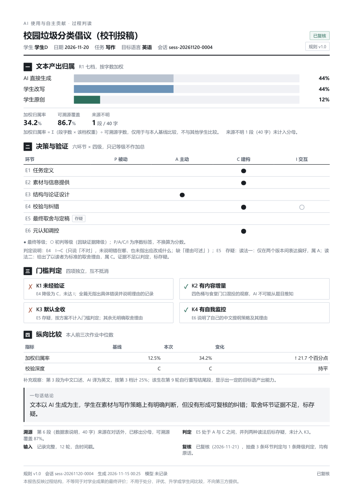

# ai-contribution-review

给教师看的「学生作业 AI 使用与自主贡献」判读工具。学生在同一个会话里用 AI 完成作业，结束时生成一页报告：**字是谁写的、判断是谁做的、有没有形成可复核的验证**。

> 它不输出总分，不做 AI 文本检测，不用于处分或评比。



## 为什么不是「AI 率」

在「老师允许或要求用 AI」的场景里，文本本来就主要由 AI 产出。用文本归属做一个百分比，等于给每个正常使用的学生都判低分，而且这个数字说不清任何事。

所以这份报告给三块**互不相加**的信息：

| 读数 | 性质 | 输出 |
|---|---|---|
| 文本产出归属 | 可观察事实 | 三条横条 + 加权归属率（唯一可算的一项） |
| 决策与验证 | 可核验行为 | 六环节 × ICAP 四级矩阵，无总分 |
| 门槛判定 | 有／无 | 四项标签：校验、素材增量、取舍、自我监控 |

三块刻意独立：任何一块都不能用来修正另一块。一份诚实说「无法评价」的报告（过程记录缺失时），比一份编造的「贡献 70%」有价值。

## 安装

放到 WorkBuddy 的用户级 skills 目录：

```bash
git clone https://github.com/<you>/ai-contribution-review.git \
  ~/.workbuddy/skills/ai-contribution-review
```

Windows：

```powershell
git clone https://github.com/<you>/ai-contribution-review.git "$env:USERPROFILE\.workbuddy\skills\ai-contribution-review"
```

依赖：Python 3.9+（只用标准库），可选 `pypdf` / `pymupdf` 用于页数校验。

## 使用

**模式 A｜开题**：教师先声明三项——目标语言、教学目标是否包含目标语言产出、任务类型。第二项决定「跨语言成文」档（25%）能否启用，缺声明时不要替学生猜。

**模式 B｜判读**：学生说「出报告」，按 SKILL.md 的八步执行：

```bash
# 1. 写判定（字段见 references/report-spec.md）→ analysis.json
# 2. 算文本归属
python scripts/compute_attribution.py analysis.json --write
# 3. 校验硬约束（必须零 ERROR）
python scripts/validate_report.py analysis.json
# 4. 渲染一页 A4
python scripts/render_report.py analysis.json
```

校验器会拦下这些：合成分数字段、无证据的 C/I 等级、降级超过一级、缺检索范围的门槛判定、缺失的不确定性标注、结论里的「表现良好」类措辞。

## 目录

```
├── SKILL.md                  # 主流程与硬约束（八步 + 四不做）
├── references/
│   ├── rules.md              # R1–R5 判据、边界判例
│   ├── report-spec.md        # 报告版式 + analysis.json 字段
│   ├── evidence.md           # 证据层级、最低证据、四类不确定性
│   ├── review.md             # 争议、复核、使用边界、信度报告
│   ├── model-rationale.md    # 贡献界定模型的构思方案（每条理论配文献）
│   └── theory.md             # 规则与文献对应速查（APA 7）
├── scripts/
│   ├── rules.py              # 七档权重、六环节、四级、四门槛
│   ├── compute_attribution.py
│   ├── validate_report.py
│   └── render_report.py
├── assets/
│   ├── report.css            # 版式，改这里即可调外观
│   └── student-notice.md     # 发给学生的一页说明
└── examples/                 # 四个可跑通的判定样例 + 渲染结果
```

## 示例

`examples/` 下四份 `analysis.json` 覆盖四种情形，每份都已渲染出单页 HTML：

| 文件 | 情形 | 加权归属率 | 门槛通过 |
|---|---|---|---|
| `example-1-single-language` | 学生用目标语口述 | 45% | 3／4 |
| `example-2-bilingual` | 学生用母语口述，AI 译为目标语 | 25% | 3／4 |
| `example-3-no-record` | 过程记录缺失 | 不出读数 | 不判定 |
| `example-4-mixed` | 含降级与存疑的混合情形 | 34.2% | 2／4 |

示例一与示例二的**决策质量完全相同**，只差口述语言，归属率相差 20 个百分点。这是规则的设计意图，也是它最容易被误读的地方——报告里专门有一栏「补充观察」作文字补偿。

## 设计取舍

| 做法 | 理由 |
|---|---|
| 不设总分 | 六环节之间存在能力相关，加权求和所需的加性独立前提不成立 |
| 等级只作序数 | ICAP 原文只给 I>C>A>P 的序，不给等级之间的距离 |
| 用门槛代替权重 | 有些东西不能交换：没做校验，不能靠字数补 |
| 与本人基线比 | 专长逆转效应：同一辅助对不同水平学生效果相反，统一阈值两边都误判 |
| 拒绝 AI 检测器 | 通用检测器对非母语写作者有系统性偏差 |
| 缺证据就写「无法判定」 | 一份诚实的空报告比一份编造的百分比有用 |

**分层有据，赋值无据。** 七档的 0/10/25/35/45/80/100 与四项门槛的位置都是经验赋值，文献支撑的是「如何分层」而非「每层值多少分」。需要按本班实际标定，不应视为成熟量表。

## 局限

- **未做效度与信度检验。** 没有构念效度、聚合效度、判别效度的证据，也没有多评判者一致性数据。
- **样本极小。** 规则参照的三份真实对话来自同一人、同一周、同一学段（大学课程）。中小学场景未验证。
- **自证性质。** 报告在学生端生成，学生可以挑选对话、编辑报告。方案通过「会话 ID + 记录随报提交」提高成本，不能消除可能。
- **构念借用。** ICAP 测学习投入，这里用它判决策深度，属借用。报告不得把等级解释为「学习效果」。

## 引用

完整的模型构思方案见 [`references/model-rationale.md`](references/model-rationale.md)——每组规则为什么这样设计、依据哪条文献、支撑强度如何，逐条列出。规则与文献的对照速查见 [`references/theory.md`](references/theory.md)，含 24 条 APA 第 7 版参考文献。核心几条：

- Chi, M. T. H., & Wylie, R. (2014). The ICAP framework. *Educational Psychologist*, 49(4), 219–243.
- Faigley, L., & Witte, S. (1981). Analyzing revision. *College Composition and Communication*, 32(4), 400–414.
- Messick, S. (1995). Validity of psychological assessment. *American Psychologist*, 50(9), 741–749.
- Bereiter, C., & Scardamalia, M. (1987). *The psychology of written composition*.
- 彭婧, 张凌, 曹艳. (2026). 数智时代人机协同学习的表层投入. *开放教育研究*, 32(5), 89–98.

## 许可

MIT。判读规则与报告版式可自由改造；改动规则时请同步 `scripts/rules.py`、`references/rules.md` 与 `SKILL.md` 三处。
