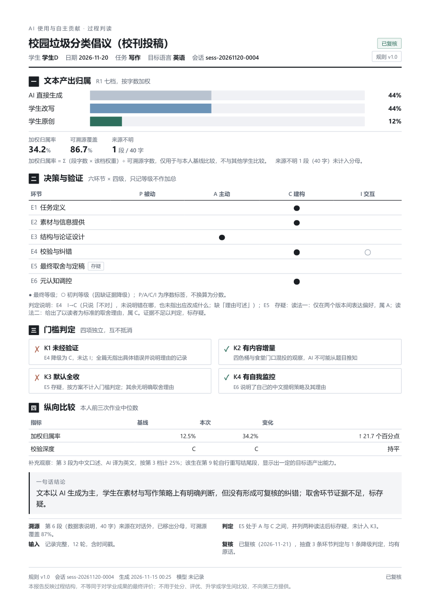

# ai-contribution-review（Agent Skills 版）

判读学生在 AI 辅助作业中的自主贡献，输出给教师看的一页报告。本包是通用 `SKILL.md` 形态，适用于支持 Agent Skills 的宿主（WorkBuddy、Claude Code 等）。

同一模型的 DSH 封装见仓库 `packages/dsh/`。两包判定规则完全一致，只差封装格式。



## 安装

```bash
# 从仓库取
git clone https://github.com/dudu20070305/ai-contribution-review.git /tmp/acr
cp -r /tmp/acr/packages/agent-skills/ai-contribution-review ~/.workbuddy/skills/

# 或直接用压缩包
unzip ai-contribution-review_agent-skills_v1.1.zip -d ~/.workbuddy/skills/
```

依赖 Python 3.9+（仅标准库）。

## 四步跑通

```bash
python scripts/compute_attribution.py analysis.json --write   # 算文本归属
python scripts/validate_report.py analysis.json               # 必须零 ERROR
python scripts/render_report.py analysis.json                 # 出单页 A4
```

判定字段见 `references/report-spec.md`；规则见 `references/rules.md`；模型为什么这样设计见 `references/model-rationale.md`。

## 目录

| 路径 | 内容 |
|---|---|
| `SKILL.md` | 八步流程与四条硬约束 |
| `references/rules.md` | R1–R5 判据、边界判例 |
| `references/report-spec.md` | 报告版式 + `analysis.json` 字段 |
| `references/evidence.md` | 证据层级、四类不确定性 |
| `references/review.md` | 争议、复核、使用边界 |
| `references/model-rationale.md` | 贡献界定模型构思方案（每条理论配文献） |
| `references/theory.md` | 规则—文献速查（APA 7） |
| `scripts/` | 归属计算、校验、渲染 |
| `assets/` | 报告样式表、学生须知 |
| `examples/` | 四种情形的 `analysis.json`（含渲染结果） |

完整说明与设计取舍见仓库根目录 README。

## 许可

MIT，见 `LICENSE`。
