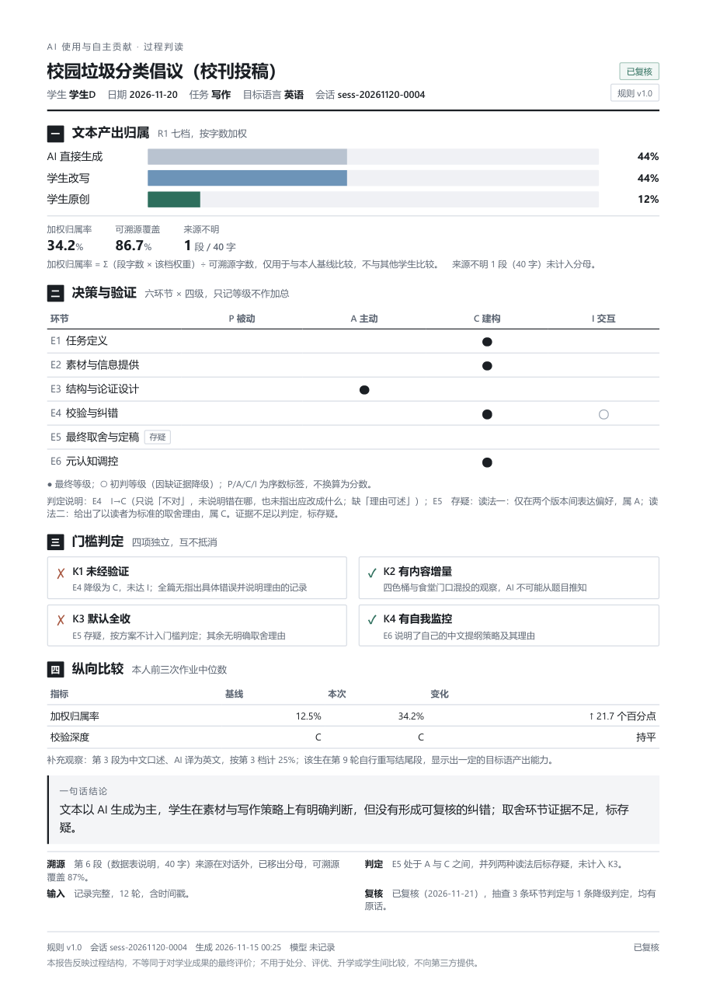

# ai-contribution-review（dsh 版）

判读学生在 AI 辅助作业中的自主贡献，输出给教师看的一页报告。

本包是 **DeepSeek Harness（dsh）** 的 skill 目录包形态。同一模型的另一种封装（Agent Skills / SKILL.md 通用形态）见 `dist/agent-skills/`。



## 安装

解压后把 `ai-contribution-review/` 整个目录放到任一被扫描的根目录：

| 作用域 | 路径 |
|---|---|
| 项目（推荐） | `<项目根>/.dsh/skills/ai-contribution-review/` |
| 项目（兼容根） | `<项目根>/.agents/skills/ai-contribution-review/` |
| 用户级 | `~/.dsh/skills/ai-contribution-review/` |
| 用户级（兼容根） | `~/.agents/skills/ai-contribution-review/` |

项目根是包含 `.git` 的最近祖先目录，找不到时用当前工作目录。

## 验证格式

```bash
python tools/check_format.py
```

检查内容：name 是否 kebab-case、目录名与 name 是否一致、必填键是否齐全、是否只用了规范列出的键、两个调用控制键是否布尔值、有没有嵌套 SKILL.md、正文四部分是否齐全。

## 本包符合的规范

依据 `deepseek-ai/deepseek-harness` 仓库的 `docs/subsystems/skills.zh.md`（发布站点：<https://deepseek-harness.github.io/deepseek-harness/>，入口亦见于 <https://api-docs.deepseek.com/> 的 Agent Tools 段落）：

- **布局**：目录包 `<root>/<name>/SKILL.md`，或扁平文件 `<root>/<name>.md`；**不支持**嵌套 `**/SKILL.md` 发现，只扫描一层。
- **名称**：kebab-case，`^[a-z0-9]+(?:-[a-z0-9]+)*$`。
- **frontmatter**：`name`、`description` 必填；`whenToUse`、`metadata`、`disable-model-invocation`、`user-invocable` 可选。
- **调用策略**：两个开关省略即默认为 `true`；值不是布尔会**整条丢弃该 skill**（fail-closed）。本包未设这两个键，即模型与用户均可调用。
- **正文**：四部分——When to use / Steps / Constraints / Acceptance，另加 Input 与资源索引。

一点实务提醒：模型侧目录只渲染 `name` + `description`，**不读 `whenToUse`**。所以触发条件写进了 description，而不是只写在 whenToUse 里。

## 结构

```
ai-contribution-review/
├── SKILL.md                     # 四段式正文，短，细节外置
├── references/
│   ├── rules.md                 # R1–R5 判据、边界判例
│   ├── report-spec.md           # 报告版式 + analysis.json 字段
│   ├── evidence.md              # 证据层级与四类不确定性
│   ├── review.md                # 争议、复核、使用边界
│   ├── model-rationale.md       # 贡献界定模型构思方案（每条理论配文献）
│   └── theory.md                # 规则与文献对应速查
├── scripts/                     # 归属计算、校验、渲染（Python 标准库）
├── assets/                      # 报告样式表、学生须知
├── examples/                    # 四种情形的 analysis.json
└── tools/check_format.py        # dsh 格式校验
```

## 与另一个封装的差别

| 项 | dsh 版（本包） | Agent Skills 版 |
|---|---|---|
| 正文结构 | 四段式：When to use / Steps / Constraints / Acceptance | 自定义章节 |
| frontmatter | 只用 dsh 列出的五个键 | 含 `allowed-tools`、`agent_created` 等扩展键 |
| 触发说明 | 写进 `description`（模型目录只读此项） | 正文首节 + description |
| 安装位置 | `~/.dsh/skills/` 或 `<项目>/.dsh/skills/` | `~/.workbuddy/skills/` 等 |
| 判定规则 | **完全相同** | **完全相同** |

规则、脚本、报告版式在两包中完全一致，差别只在封装格式。

## 许可

MIT，见 `LICENSE`。
